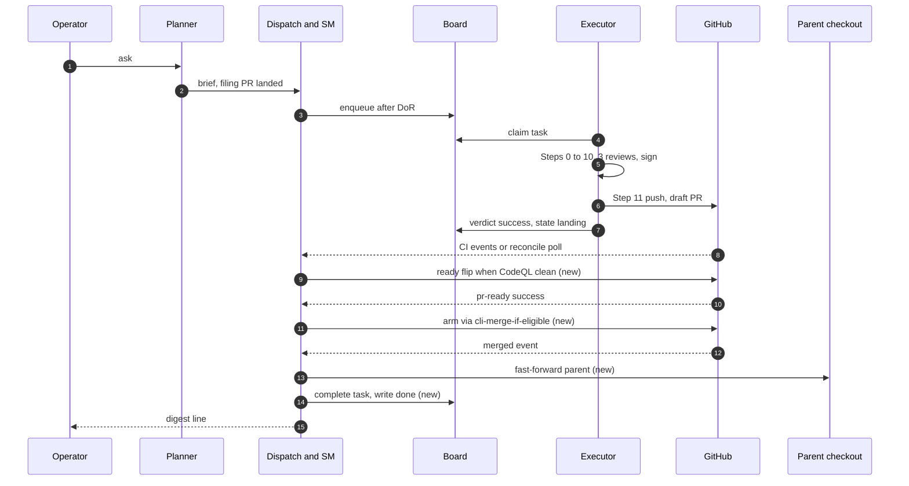
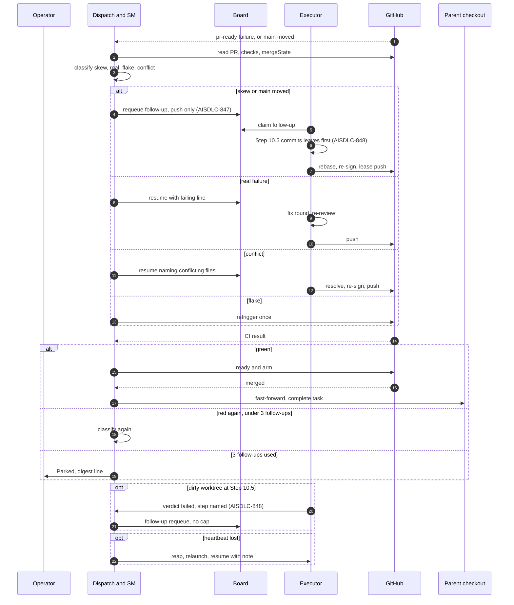

# RFC-0054: PR Lifecycle as Event-Driven Dispatch (one state machine from branch pushed to merged)

**Status:** Draft
**Lifecycle:** Draft
**Author:** Dominique Legault (drafted by an agent session on the operator's 2026-10-13 mandate)
**Created:** 2026-10-13
**Updated:** 2026-10-13
**Target Spec Version:** v1alpha1

> This RFC presents options and a recommendation. It does not resolve any Open Question. Every
> question in the Open Questions section is routed through the decision rubric
> (`decision-rubric`, Decision Catalog RFC-0035); the answers are the operator's.

---

## Summary

Two state machines describe the same unit of work and are not connected: the GitHub pull request
(draft, checks running, red, green, ready, armed, merged, conflicting) and the Dispatch Board task
(`queue/`, `inflight/`, `done/`, `failed/`, `blocked/`). The board stops at "a draft PR exists";
GitHub keeps going for hours or days with no owner. Every transition after "draft PR exists" is
driven by a poll (a 300 s dispatch tick, a planner 30-minute survey), by a workflow whose events
skip most of the time, or by a person.

This RFC proposes making the PR lifecycle one explicit state machine, fed by an idempotent stream of
PR events, with exactly one owner for every transition from "branch pushed" until "merged". It
compares four ways to get the events (a GitHub webhook to a local receiver, GitHub Actions as the
event source, poll-based reconciliation, and a hybrid of webhook and poll) and recommends an order
of work that starts with deletions that need no new code. The operator's leading candidate, a
webhook that triggers the state machine, is evaluated on equal terms with the others.

The lifecycle, its watchdog dwell times and the happy and recovery sequences are drawn in
[Lifecycle and anti-stagnation](#lifecycle-and-anti-stagnation).

## Motivation

### The problem in one picture

| | GitHub PR state | Board task state |
|---|---|---|
| Branch pushed, no PR | (none) | `inflight/` |
| Draft PR created (Step 11) | draft, CI skipped | `done/` (verdict `success`) |
| Flipped ready, CI running | ready, checks pending | `done/` |
| Red (skew, real, flake) | `ai-sdlc/pr-ready` failure | `done/` or `failed/` |
| Green, not armed | ready, CLEAN | `done/` |
| Armed | auto-merge queued | `done/` |
| Merged | merged | `done/` (unchanged) |
| Conflicting / behind | DIRTY / BEHIND | `done/` (unchanged) |

The board has no state for any row below "draft PR created". The task is "done" while the PR is
still the unit of risk. The 2026-10-11 pile-up audit
(`docs/audits/2026-10-11-pr-pileup-dispatch-role-audit.md`) recorded this as Findings 1 to 6: no
owner follows a PR until it lands, three definitions of done coexist (executor `success` = PR open;
board `done/` = verdict written; CLAUDE.md Done semantics = task file moved), the hand-off happens
at the moment a PR is most likely to go red, and readiness depends on a phrase in the PR body.
DEC-0127 (operator, 2026-10-11) set the target: done means the PR is on main. AISDLC-816 carries
that rule as a to-do; as of this draft it is not implemented.

### The poll-only clock

Every transition after "draft PR exists" is driven by a clock, not by an event:

- The dispatch tick wakes on `nextWakeSec` (30 busy, 300 working, 1800 empty, per
  `ai-sdlc-plugin/commands/operator-dispatch.md`) and, in manual mode, only when a planner or
  operator message wakes it (AISDLC-823 context: the 2026-10-12 drain idled for two hours after its
  blocking PR merged).
- The planner's 30-minute survey was the only PR watch; it stopped at 04:25Z on 2026-10-11 and the
  open list grew from 24 to 32 (pile-up audit, Finding 1).
- The only code that reacts to a CI failure on an open PR, the ci-failure-watcher
  (`pipeline-cli/src/runtime/ci-failure-watcher.ts`, AISDLC-460), is a 60 s polling loop that is not
  started by any workflow or hierarchy role; its own header lists "webhook-based push notification"
  as a deferred Phase 2. AISDLC-829 proposes deleting it.
- The GitHub-side event consumers are workflows (`auto-enable-auto-merge.yml` fires on
  `pull_request_target`, `check_suite` and `status`); the CI/CD audit
  (`docs/audits/2026-10-13-cicd-five-step-audit.md`, F4) measured 624 of its 1000 runs as
  `check_suite` events at 5 s of job time and a 64 s median wall time, and it refuses drafts.

### Incident evidence, 2026-10-13

Verified against the board files in `.ai-sdlc/dispatch/` (parent checkout) unless marked otherwise.

| Task / PR | What happened | Evidence |
|---|---|---|
| AISDLC-549 (#1407) | Approved verdict, 29 unpushed commits (per the operator's incident log), requeue cap reached | `failed/AISDLC-549.manifest.json` has `retryCount: 2`; verdict 01:40Z says "Not pushed ... non-fast-forward; lease push ... refused by pre-push attestation-sign ... reviewer set incomplete". The 29-commit count is not in the verdict note. |
| AISDLC-742 (#1248) | Reviews approved 3/3; Step 10.5 stopped with `rebase-conflict` while no rebase was in progress; the worktree was dirty (4 deleted attestations, modified reviews and transcript leaves); branch 8 commits behind main | `failed/AISDLC-742.verdict.json` 01:21Z. The board shows `retryCount: 1`, not 2, so "same as 549" holds for the symptom (no sanctioned way back), not for the cap. |
| AISDLC-764 (#1368) | Step 0.5 refused: 12 untracked `.ai-sdlc/_decisions/events` files (DEC-0160..0165) in the parent; escalated as DEC-0166 | `failed/AISDLC-764.verdict.json` 04:34Z. The operator log also says the developer agent tried a refused push after a local rebase; that is not in the verdict note and is unverified here. |
| AISDLC-825 | Failed pre-push on missing `orchestrator/dist` and no task-citing commit subject | From the operator's log. The board shows 825 later in `done/` after a push-only resume (rebase, build, re-sign, lease push, ready flip). |
| AISDLC-827 (#1449) | Step 10.5 preSignRebase on a dirty worktree reported "conflict unknown" | From the operator's log; 827 is `inflight/` at step `05-dev-running` in the snapshot read. Unverified beyond the log. |
| Executor `alpha` | Reaped on stale heartbeat, not relaunched for hours | From the operator's log. AISDLC-826 (#1450, merged 2026-10-13) added stall detection and relaunch to the tick. |
| Four drafts 2 to 3 days old | Never flipped ready: the pipeline ends at "draft PR exists" and the auto-enable workflow refuses drafts | Pile-up audit Finding 4 records the same class on 2026-10-11 (#1402 to #1407). |
| PR lifetime | Median 42 min, p25 12 min, p75 356 min, 17 of 80 merged PRs over 12 h; code PRs are green 9 to 14 min after the last push | CI/CD audit section 1 and F1: "The crawl is landing, not CI." |
| Reachability | Dispatch could not act: executors are reachable only through the board, a resume signal requires an inflight claim, cross-session messages go only to the dispatch entry of the roster, and a `failed/` task past the retry cap has no sanctioned re-entry | `pipeline-cli/src/dispatch/resume.ts` (resume works on a `done/` task or an iterate-needed inflight claim), `requeue.ts` (retry limit), `planner.md` ("messages only the dispatch entry"), AISDLC-828 |
| Parent debris | Executors flip task status in the parent; dispatch's decision answers landed in the parent events log, which is what blocked 764's Step 0.5 | Board verdict for 764; AISDLC-825 (merged, #1454) addresses where decisions are filed from a task worktree. |

The pattern is the same in every row: the work that remains after "PR exists" is mechanical
(rebase, re-sign, lease push, flip ready, arm), is known to the repository (PR state is on GitHub,
task state on the board), and has no owner and no trigger.

## Goals

- One state machine for a task's PR, from "branch pushed" to "merged", with one named owner for every
  transition and one definition of done (DEC-0127).
- Every transition is triggered by an event or by a reconciliation that is safe to run at any time
  (idempotent), never by "someone noticing".
- A recovery path for every non-happy state (red, conflicting, stalled, past-retry-cap) that does not
  need a planner ruling when the shape is mechanical.
- Delete before adding: phase 0 removes requirements and mechanisms that need no new code.
- An approach that works on an operator laptop (NAT, sleep, rotating auth) and degrades to correct,
  slower behaviour when the laptop is closed.

## Non-Goals

- Changing the review pipeline, attestation format (RFC-0042) or the merge gate
  (`cli-merge-if-eligible`, `governance.allowMerge`). The state machine arms and merges only through
  existing sanctioned paths.
- Resolving the design questions below. This RFC lists them with options.
- Replacing the session hierarchy (RFC-0051) or the Dispatch Board (RFC-0041). The board gains
  states; its claim and ordering semantics stay.
- A multi-repository or SaaS control plane.

## Current tooling inventory

Clock column: **event** = reacts to a GitHub or filesystem event; **poll** = wakes on a timer;
**manual** = needs a person or another agent to start it.

| Component | Event it produces / consumes | Owner role | Clock | Recovery path when it fails |
|---|---|---|---|---|
| `ai-sdlc-gate.yml` (`ai-sdlc/pr-ready` rollup, 14 jobs) | Consumes `pull_request` opened/synchronize/reopened/ready_for_review; produces the required check | CI | event | Push again; executor resume with a note; `retrigger-ci` playbook action |
| `auto-enable-auto-merge.yml` | Consumes `pull_request_target`, `check_suite`, `status`; arms `--auto --squash` on same-repo PRs; refuses drafts | CI (acts as the PR author's PAT) | event, but 624 of 1000 runs are `check_suite` noise | Re-trigger by ready flip or a new push; no owner if it skips |
| `ai-sdlc-fix-ci.yml` | Consumes `workflow_run` completed; acts on failures of `ai-sdlc/issue-*` branches only (100% skipped over 7 days per the CI/CD audit F4) | CI | event | None observed; effectively dead |
| ci-failure-watcher (`pipeline-cli/src/runtime/ci-failure-watcher.ts`) then `ci-conflict-resolver` agent | Polls `gh pr list` every 60 s; classifies stale-base shapes; spawns the resolver (cap 2); 24 h cool-down file per PR | nobody (not started by any role; the only PR-failure to agent bridge in code) | poll, dormant | `/ai-sdlc resolve-conflicts <pr>` by hand; AISDLC-829 proposes deleting it |
| dependabot / CodeQL default setup / Scorecard / release-please (`release.yml`) | GitHub-native or push-main events; CodeQL runs on every PR (Go costs about 2 min, CI/CD audit F3); release-please keeps one rolling `chore: release main` PR | CI / operator (release merge is operator-only, DEC-0042) | event (Scorecard weekly cron) | Operator action; `cli-merge-if-eligible --source-kind release --arm` |
| `main-health-monitor.yml` / `ci.yml` | Push to main; nightly; opens `[main-health]` issue | CI | event + cron | Issue assigned to the operator |
| Dispatch Board (`.ai-sdlc/dispatch/{queue,inflight,done,failed,blocked}`) | Producers: dispatch (enqueue), executors (claim, verdict). Consumers: executors, tick | dispatch | filesystem state, claim is an atomic rename | `requeue` (retry limit 2), `resume` (needs a `done/` task or an iterate-needed claim), `reap` |
| Requeue + retry cap (`dispatch/requeue.ts`) | Increments `retryCount`; refuses past the limit (a "mistake guard", cap at most 2) | dispatch | manual (operator or tick playbook) | Planner ruling (AISDLC-828 proposes bypass when a PR is open) |
| Resume signal (`dispatch/resume.ts`) | Writes `<id>.resume.json` beside an inflight claim; the next claim reads the note | dispatch | manual | Only works with an inflight claim or a `done/` task |
| Reap / heartbeat (`dispatch/session-reaper.ts`, `hierarchy/stall.ts`, AISDLC-826) | Heartbeat per pipeline step; stale after 30 min (RFC-0041 OQ-3) or holder-not-busy grace; moves claim to `failed/` and requeues with a note naming the stalled step | dispatch tick | poll | Relaunch on the tick |
| `cli-hierarchy` roster / `tick` / `markReady` / `up` / `down` / `restart` / `clear` | Tick = ingest briefs, watch verdicts, run playbook on failures only, emit reports, `markReadyAfterCodeql`. `markReady` flips only drafts whose body says "draft until CodeQL is clean" (pile-up audit Finding 4) | dispatch | poll (300 s working; manual wake in practice) | Planner message wakes dispatch |
| Auto-clear Stop hook (AISDLC-766) | Clears a context at a usage threshold | each session | event (Stop hook) | Manual `/clear` |
| Cross-session UDS messaging and `check-sender` | Planner messages only the dispatch entry; executors accept instructions only from their roster's dispatch session by pid or harness ref; planner is held for the operator | hierarchy | event, but sender-gated | `cli-hierarchy check-sender` fails open with a warning when no pid or ref is reported |
| Step 0 to 13 pipeline | Ends at Step 11 (push, draft PR) and Step 13 (cleanup); Step 10.5 `preSignRebase` and `11-late-rebase` exist because the base moves during a 20 to 40 min dev run | executor | manual (runs once per claim) | Resume on a new claim |
| Pre-push hook chain (11 scripts: dark-code, squash chores, fixups, task-moved, attestation-sign, others) | Consumes `git push`; mutates the branch, then exits 1 so the push is repeated | executor | event (push) | `AI_SDLC_SKIP_*` or the master bypass (documented emergency only) |
| Attestation head-binding (RFC-0042, AISDLC-810) | Envelope subject must be an ancestor of HEAD or an attestation-only descendant; any rebase orphans the subject and forces a re-sign | executor / hook | event (push) | Hook re-signs from the verdict file with no reviewer round; with no verdict or `.active-task` the push fails and the review is repeated |
| `cli-merge-if-eligible` + governance PreToolUse hook | Sanctioned arm/merge path; the hook refuses raw merge commands, including `--auto` | dispatch / operator | manual call | AISDLC-816 AC-4 would have the tick call it |
| Decision Catalog (`cli-decisions`) | `decision-opened`, `operator-answered` events in `.ai-sdlc/_decisions/events/` | planner / dispatch | manual | `operator-digest` |

Observations the table makes visible:

1. Only the gate, the auto-enable workflow and the hooks are event-driven, and they act on a push or a
   CI result, not on a PR's lifecycle. Everything that closes a lifecycle gap is poll or manual.
2. The one component that bridges "CI failed on an open PR" to an agent is dormant code with no owner.
3. Four different retry or recovery vocabularies exist (requeue, resume, reap, resolve-conflicts)
   with different preconditions on board state; none is keyed on PR state.
4. The messaging rules (planner to dispatch only, executors accept only their dispatch) mean the only
   route to an executor is a board manifest or resume signal. That is intentional (RFC-0051 OQ-1) but
   it makes the board the only API, and the board has no PR states.

## Five-step pass (DEC-0090 order)

The Five-step review (requirements first) for this RFC, applied in order. Deletion candidates are
recommendations; any deletion that loosens a governance control is a class (b) decision for the
operator (see Open Questions).

### 1. Make the requirements less dumb

| Requirement | Set by | Question |
|---|---|---|
| "A task is done when its PR is open" | RFC-0012 Step 11 hand-back design, carried into RFC-0051's executor loop | Already replaced by DEC-0127 (operator, 2026-10-11). Not yet implemented (AISDLC-816, To Do). |
| "Retry cap of 2 on `requeue`" | `requeue.ts`, mistake guard | Written to stop churn on tasks that never produced a PR. Is it measuring the right thing? A PR follow-up is not a retry. |
| "A resume signal needs an inflight claim" | `resume.ts` precondition | Why does a mechanical finish need a claim? The claim is the executor's lease, not a prerequisite for a note. |
| "Dispatch acts only when woken by a message" | RFC-0051 assumption, planner 2026-10-06 (AISDLC-823) | Who benefits from the planner being the clock? |
| "Dispatch sends only what the board carries" | RFC-0051 OQ-1, operator | Keep. The question is only what the board is allowed to represent. |
| "mark-ready flips on a phrase in the PR body" | `mark-ready.ts` | A state test (CodeQL clean, not superseded) does the same job without the phrase (AISDLC-816 AC-9 area). |
| "Three definitions of done" | Accretion | One is enough. |
| "Executors flip task status in the parent" | Step 4 / `task_edit` Pattern C routing | The parent is read-only by rule; the flip is debris. |
| "Every push re-runs 9 to 10 workflows" | Accretion | Out of scope here; the CI/CD audit owns it. This RFC only asks that the event stream not depend on workflows that skip. |

### 2. Delete the part or process

Candidates, in rough order of confidence. "If you are not adding back 10% of what you deleted, you
did not delete enough": the likely add-back is named in brackets.

- The retry cap as a mistake guard on PR follow-ups. [Add back: a cap on consecutive failures of the
  same classified shape, which is a real runaway guard.]
- The "resume needs a claim" precondition. [Add back: resume of a task whose PR is merged or closed
  is refused.]
- The planner "tick" as a precondition for dispatch work. [Add back: the planner is still told about
  anything outside the operational list.]
- Three definitions of done; keep "PR on main" (DEC-0127).
- The dispatch tick as the thing that schedules itself and polls for everything; replace the many
  special cases with classification of PR state in one place.
- The dormant ci-failure-watcher and the `resolve-conflicts` command as a parallel PR-failure path
  (AISDLC-829 already proposes it).
- Duplicate parent status flips (executor `task_edit` in the parent).
- The `ai-sdlc-fix-ci.yml` branch-prefix filter (100% skipped in 7 days), as part of the CI/CD audit.

### 3. Simplify or optimise (only after step 2)

- One PR state classifier (a pure function from `{PR json, check runs, board record}` to one state)
  and one action table. AISDLC-823 already contains such a table; this RFC makes it the contract.
- One owner per transition (see the ownership table below).
- One event schema with an idempotency key, whatever the source.
- Merge the board verdict into the PR state: `done/` is written only on `merged`; `landing/` is the
  state between "PR exists" and "merged" (AISDLC-816 AC-2).

### 4. Accelerate cycle time (only after steps 1 to 3)

- A red or conflicting PR returns to the board within one event (or one reconciliation) instead of
  one planner ruling.
- Arm and ready-flip on the first green observation, not on the next tick.
- Run the mechanical finish (rebase, re-sign, lease push) as a deterministic script without a model
  turn where the shape is known (stale attestation subject, stale base). Mechanical work should not
  be wrapped in subagents (CLAUDE.md, subagent model defaults).

### 5. Automate (last, never first)

- Event delivery (webhook, forwarder, workflow, or reconciler) is the automation step. It is last on
  purpose: with phase 0 and the state machine in place, a 5-minute poll already closes most of the
  gap, and the event source is an optimisation of latency, not of correctness.

**Velocity impact.** Positive by construction: phase 0 removes work, the state machine removes the
planner round trip for mechanical PR stops (ten of eleven resumes on 2026-10-11 were the same ruling,
pile-up audit Finding 6), and the median 42 minute lifetime is dragged to hours by the p75 tail that
this RFC targets. Costs are listed per option below.

## Proposal

### The state machine

States for the PR of one task. The state is derived, never stored as the only copy: it can always be
recomputed from `{GitHub PR, check runs, board record}`.

```
branch-pushed -> draft-pr -> ci-running -> green -> ready -> armed -> merged
                                  |           ^        ^
                                  v           |        |
                     red(skew | real | flake) +--------+
                                  |
                     conflicting (DIRTY/BEHIND)  --- any state may enter
                     stalled (no heartbeat / no owner) --- any non-terminal state may enter
                     closed-unmerged (terminal, flagged: KPI per memory note)
```

Ownership table (proposal; Open Question 2 asks whether to approve it):

| Transition | Event that triggers it | Owner | Action |
|---|---|---|---|
| branch-pushed to draft-pr | Step 11 push + PR create | executor | Step 11 (unchanged) |
| draft-pr to ci-running | `ready_for_review`, or push on a ready PR | state machine | Flip ready when CodeQL is clean and the verdict is approved (by state, not phrase) |
| ci-running to green / red | `check_suite` or `workflow_run` completed, or `ai-sdlc/pr-ready` status | CI | none (observed) |
| red(skew) | classified: stale base, stale attestation subject, cancelled/superseded check | state machine | Mechanical finish: rebase, drop the stale envelope, lease push so the hook re-signs; no reviewer round |
| red(real) | classified: test, lint, coverage failure on the current head | executor (the one that made the PR), by resume with the failing line | Fix, re-review, push |
| red(flake) | classified: infra, cancelled with no newer run | state machine | Retrigger once, then reclassify |
| green to ready to armed | first green observation on a CLEAN PR | state machine | `cli-merge-if-eligible --arm` under the existing grant |
| armed to merged | `pull_request` closed with `merged: true` | GitHub | State machine writes `done/`, syncs the parent, releases the next claim (DEC-0127) |
| any to conflicting | `mergeStateStatus` DIRTY/BEHIND | state machine | Rebase path as above; if semantic, return to the executor |
| any to stalled | heartbeat/owner absent beyond threshold (AISDLC-826) | state machine | Reap, relaunch, resume with a note naming the step |

### What is common to every option

Whatever the source of events, three properties hold (they are the part of the design that is not
in question):

1. **Event record.** A PR event becomes a file in a board-adjacent directory
   (`.ai-sdlc/dispatch/events/`), named by an idempotency key
   `<repo>#<pr>@<headSha>:<event-kind>:<delivery-or-updatedAt>`, containing only fields GitHub
   supplied. Ingest is create-if-absent; replays are no-ops.
2. **Reconciliation is always possible.** The classifier can be run over `gh api` REST output at any
   time and must produce the same state the events would have produced. No option may make events the
   only source of truth.
3. **Actions use sanctioned paths.** Arm via `cli-merge-if-eligible --arm`; push via the lease-push
   form; re-sign via the attestation hook; no new bypass.

## Design options

### Option A: GitHub webhook to a local receiver

**Event source.** A GitHub repository webhook (events: `pull_request`, `check_suite`, `check_run`,
`workflow_run`, `status`, `pull_request_review`) delivered to a local listener. Delivery paths:
`gh webhook forward` (a developer-oriented CLI extension that opens a websocket and forwards to a
localhost URL), a smee.io-style relay, or a tunnel to a tiny HTTP listener in `pipeline-cli`. The
receiver validates `X-Hub-Signature-256` (HMAC with a shared secret) and writes the event record.
The tick wakes on a new record (filesystem watch), classifies, acts.

**State machine and owners.** As in the table above; the receiver only writes events, the
dispatch-owned machine acts.

**Recovery.** None built in: if the laptop sleeps or the forwarder drops, events are lost.
GitHub keeps recent deliveries for redelivery (the delivery log is retrievable through the API for a
limited time; exact retention is not verified here), so a catch-up pass is possible, but it is a
reconciliation by another name.

**Failure modes.** Forwarder disconnect; secret rotation; duplicated or out-of-order deliveries
(handled by the idempotency key and by re-reading the PR); a listener that accepts untrusted bodies
(must verify the signature before parsing); a public relay seeing PR metadata.

**Cost.** Tokens: none for ingest (receiver is deterministic). Runner minutes: zero. Operator
attention: set up and keep a forwarder alive; maintain a webhook secret; a new always-on process on
the laptop (similar to the roster sessions it would sit beside).

**Blast radius.** A compromised or misconfigured receiver can inject events. Mitigation: events are
hints that trigger a re-read from GitHub through authenticated REST; no action is taken on payload
contents alone.

**What it deletes.** The poll interval as the clock; the dormant ci-failure-watcher; the planner
survey as a PR watch.

### Option B: GitHub Actions as the event source

**Event source.** A single small workflow (`pull_request`, `workflow_run`, `check_suite`) classifies
the PR on GitHub's side and writes the state where the local machine can read it with one cheap call,
without an inbound connection. Candidate sinks (each with a downside): a PR label such as
`lifecycle:red-skew` (visible, human-readable, rate-limited and noisy in timelines); a commit status
or check run (no repo write, but ephemeral per SHA); a comment (dedup problems); a commit to a
`events` branch (history noise and write permissions); `repository_dispatch` (needs a consumer, which
is a poll again). The local tick lists PRs with one REST call and reads the sink.

**State machine and owners.** Classification moves to CI; actions that need the signing key,
worktrees or the plugin stay local (see the read-only remote-agent constraints in CLAUDE.md); CI-side
actions are limited to labels, retriggers and ready flips.

**Recovery.** If the workflow is skipped (path filters, runner queue, the 5 s job with a 64 s queue
wait measured by the CI/CD audit), the next reconciliation reads PRs directly.

**Failure modes.** Workflow permission and `GITHUB_TOKEN` limits (actions taken by `GITHUB_TOKEN` do
not trigger further workflows); queue latency during the exact periods that matter (a 150-run queue
was observed on 2026-10-10); another workflow added to a repository whose audit says there are too
many.

**Cost.** Tokens: none. Runner minutes: small per event but nonzero (the audit counts runner minutes
as a pressure). Operator attention: one more workflow to keep correct; no always-on local process.

**Blast radius.** Workflow with write permission on PRs; `pull_request_target` carries the usual
untrusted-code cautions. Smallest inbound surface of the four.

**What it deletes.** The ci-failure-watcher; the `check_suite`-triggered auto-enable noise if the new
workflow absorbs arming for the CI side.

### Option C: Poll-based reconciliation (the minimal change)

**Event source.** None external. `cli-hierarchy tick` already wakes on `nextWakeSec`; it additionally
runs `gh pr list --state open --json number,headRefName,isDraft,mergeStateStatus,statusCheckRollup`
(or REST `pulls` plus `check-runs` for the roster's PRs), diffs against the stored per-PR state, and
emits the same event records the other options would write. This is the AISDLC-823 and AISDLC-829
design (15-minute or 300 s poll, REST only, classifier in `pipeline-cli/src/hierarchy/`).

**State machine and owners.** As in the table. The tick is the only actor.

**Recovery.** Self-healing by construction: each tick recomputes state from GitHub.

**Failure modes.** Latency equal to the interval; API rate limit (one list call per tick is far below
limits); a tick that is not scheduled (the AISDLC-823 problem: nothing wakes dispatch) so the
scheduling requirement is part of this option; a PR with no task id (filing PRs) is reported, not
requeued.

**Cost.** Tokens: none for the poll, a model turn only when an action needs judgment. Runner
minutes: zero. Operator attention: lowest, no new process or secret.

**Blast radius.** Smallest: authenticated pull with the operator's existing `gh` token, no inbound
surface.

**What it deletes.** The ci-failure-watcher; the planner survey; the "message wakes dispatch"
assumption (if the tick schedules itself).

### Option D: Hybrid, webhook when a listener is up, poll as the fallback reconciler

**Event source.** Options A or B feed the same event directory as Option C. Events are hints;
the poll runs at a longer interval (for example 15 minutes) when a listener is healthy and at the
short interval when it is not. All ingestion is idempotent, so double delivery is harmless.

**State machine and owners.** Identical to C; the only addition is a listener health signal that
chooses the poll interval.

**Recovery.** The reconciler covers every gap (laptop closed, forwarder down, workflow skipped).

**Failure modes.** The union of A or B and C, with the benefit that none of them is load-bearing for
correctness. The added risk is operational: two paths to test, and the temptation to treat the fast
path as the real one.

**Cost.** Tokens: none. Runner minutes: zero (A) or small (B). Operator attention: the listener
setup of A or B, plus nothing for correctness.

**Blast radius.** That of the chosen event source, limited because events never carry authority.

**What it deletes.** Same as C, plus the poll interval as the latency floor.

### Comparison

| Criterion | A: webhook to local | B: Actions as source | C: poll reconcile | D: hybrid |
|---|---|---|---|---|
| Latency to react | Seconds to tens of seconds when connected | A workflow queue wait (64 s median measured for a 5 s job; spikes to a long queue) plus the local read interval | The poll interval (60 to 300 s; 15 min proposed in AISDLC-823) | Seconds when the fast path is up, else C |
| Works on an operator laptop (NAT, sleep, auth) | Needs a forwarder or tunnel; websocket and tunnels drop on sleep; secret to manage | Yes; no inbound connection; needs a local read | Yes; needs only `gh` auth | Yes; degrades to C |
| Laptop closed | Events lost until reconciliation | Events stored on GitHub (labels/statuses) and read on wake | Nothing happens; first poll on wake catches up | Same as C |
| Security surface | Inbound HMAC-validated endpoint or relay; secret rotation; payload parsing | Workflow with write permission; `pull_request_target` caution; no inbound | None new (authenticated pull) | That of the fast path chosen |
| Idempotency | Required (redelivery, out of order); key by delivery id plus head SHA | Required (re-run, cancelled runs) | Natural (recompute) | Required, shared ingest |
| New moving parts | Receiver/forwarder, secret, health check | One workflow, sink convention | Classifier and a scheduling guarantee | All of the chosen path plus C |
| Runner minutes | 0 | Small, nonzero | 0 | 0 or small |
| Operator attention | Moderate (keep it up, rotate secret) | Low-moderate | Lowest | Moderate (but optional) |
| Deletes | Poll clock, watcher | Watcher, some workflow noise | Watcher, planner survey | Same as C plus latency floor |
| Failure when broken | Silent gap until reconcile | Silent skip until reconcile | Slow, but visible | Slow, visible |

## Lifecycle and anti-stagnation

These diagrams depict the **recommended design** (Option C as the core, a fast path later, per the
Recommendation below). They are illustrations of that recommendation, not decisions: where an Open
Question changes the picture, the note says "per OQ-n" and the diagram shows the recommended answer
only as a placeholder. Legend: `[today]` marks a transition that exists now (possibly driven by a
person or a poll); `[new]` marks a transition this RFC proposes. Owners: executor, dispatch (the
tick), SM (the proposed state machine, which runs inside dispatch per OQ-2 and OQ-8), GitHub,
operator. Dashed-border states in the first diagram are new.

### 1. State diagram: one unit of work from intake to main

The diagram follows one task from filing to a landed PR with the parent checkout fast-forwarded and
the task file in `backlog/completed/`. The side states (Conflicting, Stalled, Failed, Parked) can be
entered from any non-terminal state; to keep the picture readable they are drawn from the state
where they most often occur, and the anti-stagnation table below lists the entry rules. Failed means
the board `failed/` directory; Parked means a decision is open for the operator.

```mermaid
stateDiagram-v2
    direction LR
    [*] --> Filed : task or issue filed [today] planner
    Filed --> DoR : filing PR landed [today] dispatch
    DoR --> Held : verdict needs-clarification [today] dispatch
    DoR --> Queued : verdict ready [today] dispatch
    Held --> DoR : task edited [today] planner
    Queued --> Claimed : executor claims, worktree made [today] executor
    Claimed --> Developing : Step 5 dev spawned [today] executor
    Developing --> Reviewing : dev returns [today] executor
    Reviewing --> Developing : changes requested [today] executor
    Reviewing --> Signed : 3 approvals, leaves emitted [today] executor
    Signed --> DraftPR : Step 11 push [today] executor
    DraftPR --> CIRunning : ready flip by state test [new] SM
    CIRunning --> Green : pr-ready success [today] GitHub
    CIRunning --> RedSkew : stale base or subject [new] SM
    CIRunning --> RedReal : test lint coverage fail [new] SM
    CIRunning --> RedFlake : infra or cancelled [new] SM
    RedSkew --> Signed : rebase and re-sign follow-up [new] SM
    RedFlake --> CIRunning : retrigger once [new] SM
    RedReal --> Developing : fix round resume [new] SM
    Green --> Ready : CLEAN and approved [new] SM
    Ready --> Armed : arm via sanctioned CLI [new] SM
    Armed --> Merged : PR closed as merged [today] GitHub
    Merged --> Landed : parent ff and task completed [new] SM
    Landed --> [*]

    CIRunning --> Conflicting : mergeState DIRTY or BEHIND [new] SM
    Armed --> Conflicting : mergeState DIRTY [new] SM
    Conflicting --> Signed : rebase and re-sign [new] SM
    Conflicting --> Developing : semantic conflict, files named [new] SM
    Claimed --> Stalled : no heartbeat 30 min [today] dispatch
    Developing --> Stalled : no heartbeat 30 min [today] dispatch
    Reviewing --> Stalled : no heartbeat 30 min [today] dispatch
    Stalled --> Queued : reap and relaunch with note [today] dispatch
    Developing --> Failed : verdict failed [today] executor
    Failed --> Queued : follow-up requeue, no cap [new] SM
    RedReal --> Parked : 3 follow-ups used [new] SM
    Conflicting --> Parked : 3 follow-ups used [new] SM
    Failed --> Parked : second reaction failed [new] SM
    Held --> Parked : held beyond 24 h [new] SM
    Parked --> Queued : operator answers decision [today] operator

    classDef proposed stroke-dasharray: 5 5
    class RedSkew,RedReal,RedFlake,Ready,Armed,Landed,Conflicting,Parked proposed
```



Transition and owner reference:

| Transition | Event | Owner | Today or new |
|---|---|---|---|
| Filed to DoR | filing PR landed, DoR check runs | dispatch | today (DoR is a CI check plus the tick) |
| Queued to Claimed | atomic rename into `inflight/` | executor | today |
| Reviewing to Signed | 3 verdicts approve, leaves emitted, attestation signed | executor | today |
| Signed to DraftPR | Step 11 push and PR create | executor | today |
| DraftPR to CIRunning | draft flipped ready by a state test (CodeQL clean, verdict approved) | SM | new (today a phrase in the PR body, AISDLC-816) |
| CIRunning to Green or Red | `ai-sdlc/pr-ready` conclusion | GitHub | today for the check, new for the classification |
| Red and Conflicting reactions | classifier output | SM | new (replaces planner rulings and the dormant watcher) |
| Ready to Armed | first green on a CLEAN PR | SM | new (today `auto-enable-auto-merge.yml` skips drafts and noisy events) |
| Merged to Landed | merged event or reconcile | SM | new (DEC-0127, AISDLC-816) |
| Stalled to Queued | heartbeat stale 30 min | dispatch | today (AISDLC-826) |
| Parked to Queued | decision answered | operator | today |

Per OQ-2 the SM owner is a placeholder for whoever OQ-2 names; per OQ-5 `Landed` may split into
`delivered` and `landed`; per OQ-7 the push and the draft step may move into the machine.

### 2. Anti-stagnation table

Every state has a maximum dwell time, a detector, an automatic reaction and an escalation if the
reaction fails twice. Dwell numbers are proposals derived from measurements in this RFC: CI median
13 min (code PRs green 9 to 14 min after the last push), main moves about every 18 min, tick 5 to 30
min, heartbeat stale at 30 min. A watchdog fires at the max dwell; the reconcile pass runs at least
every tick, so detection latency is at most one tick. Only Parked waits on a person, and it always
carries a line in the operator digest (`cli-decisions operator-digest`).

| State | Max dwell | Detector | Automatic reaction (who) | If it fails twice | 2026-10-13 failure seen here |
|---|---|---|---|---|---|
| Filed | 30 min | poll reconcile: filing PR landed, no board record | dispatch ingests the brief, runs DoR | Parked with digest line | filing PRs the planner cannot lease-push (memory: filing hygiene) |
| DoR | 15 min | poll reconcile: DoR result present, task not routed | dispatch routes to Queued or Held | Parked | none seen |
| Held | 24 h | poll reconcile: held task, no edit | dispatch sends the DoR violations to the planner, who edits the task | Parked (digest names the violations) | none seen |
| Queued | 30 min with an idle executor | poll reconcile: eligible task, idle executor, no claim | dispatch hands the next task to the idle executor | relaunch executor, then Parked | alpha reaped and not relaunched for hours |
| Claimed | 10 min | heartbeat: no step recorded after claim | dispatch reaps and relaunches with a note naming the step | Failed, then follow-up | AISDLC-764 Step 0.5 refused over parent debris |
| Developing | 60 min, or heartbeat stale 30 min | heartbeat | dispatch reaps, relaunches, resumes from the last good step | Failed, follow-up | AISDLC-827 stale worktree during dev |
| Reviewing | 45 min, or heartbeat stale 30 min | heartbeat | dispatch reaps, relaunches, resumes from existing leaves (no new reviewer round if leaves match HEAD) | Failed, follow-up | AISDLC-549 reviewer set incomplete |
| Signed | 10 min | poll reconcile: verdict signed, branch not pushed | SM runs the push-only follow-up: rebase, build, re-sign, lease push (Step 10.5 dirty worktree fixed per AISDLC-848) | Failed, follow-up, then Parked | AISDLC-742 dirty worktree at Step 10.5; AISDLC-825 missing dist; 549 unpushed commits |
| DraftPR | 10 min | webhook or poll reconcile: draft, verdict approved, CodeQL clean | SM flips ready by state test | Parked | four drafts 2 to 3 days old |
| CIRunning | 30 min (about 2.3x the 13 min median) | Actions status or poll: checks pending beyond dwell | SM retriggers once, then reclassifies | Parked with the run link | auto-enable noise: 624 of 1000 runs were check_suite |
| RedSkew | 15 min | webhook or poll: failure classified skew | SM requeues a follow-up: rebase, drop stale envelope, lease push, hook re-signs | Parked after 3 follow-ups | stale attestation subject after a rebase |
| RedReal | 20 min to resume | webhook or poll: failure classified real | SM resumes the executor with the failing line; fix round | Parked after 3 follow-ups | no automatic path today |
| RedFlake | 15 min | webhook or poll | SM retriggers once | reclassify as real, then fix round | cancelled and superseded checks |
| Green | 5 min | webhook or poll: green, not ready or not armed | SM marks Ready and arms in the same pass | Parked | green drafts never flipped |
| Ready | 5 min | poll reconcile: ready and CLEAN, not armed | SM arms via `cli-merge-if-eligible --arm` | Parked (check the grant) | auto-enable skipped some events |
| Armed | 45 min (main moves about every 18 min, so two to three rebase windows) | poll: armed, not landed | SM checks mergeState: BEHIND or DIRTY enters Conflicting; otherwise re-arm | Parked | armed PRs stuck behind a moving base |
| Conflicting | 20 min | webhook or poll: DIRTY or BEHIND | SM mechanical rebase and re-sign; semantic conflict returns to the executor naming the files | Parked after 3 follow-ups | AISDLC-742 branch 8 commits behind |
| Merged | 10 min | merged event or poll | SM fast-forwards the parent, completes the task file, writes `done/` | Parked | parent debris blocking 764 |
| Stalled | 30 min heartbeat stale (existing) | heartbeat | dispatch reaps and relaunches (AISDLC-826) | Failed, follow-up | alpha not relaunched |
| Failed | 15 min | poll: task in `failed/` with an open PR or branch | SM follow-up requeue with no retry cap (per OQ-3) and a note naming the stalled step | Parked | 549 past the cap, no sanctioned re-entry (AISDLC-828) |
| Parked | no timer; digest every tick | operator digest | none by design: the digest line names the decision and the next step | n/a | DEC-0166 for 764 |

### 3. Sequence diagrams

#### 3a. Happy path

The path of one task from brief to landed, with the machine acting at each point where the executor
used to stop (per OQ-2 and OQ-7 the exact owner of ready and arm may differ).



| Step | Owner | Today or new |
|---|---|---|
| 1 to 4 intake and claim | planner, dispatch, executor | today |
| 5 to 7 build, review, push | executor | today |
| 8 board state `landing` | executor writes, SM owns | new (AISDLC-816) |
| 10 to 13 ready, arm | SM | new |
| 14 to 16 land | SM | new (DEC-0127) |

#### 3b. Recovery path: main moved, or the PR went red

The loop is a follow-up, not a retry: each pass is classified from GitHub facts, runs a bounded
mechanical or fix action, and goes back to CI. The bound is 3 follow-ups per PR, after which the PR is
Parked and one digest line names the last classification. The bound value and its scope are per OQ-3.



| Branch | Detector | Reaction | Bound | Escalation |
|---|---|---|---|---|
| Skew or main moved | CI red event or mergeState BEHIND | push-only follow-up (AISDLC-847) | 3 per PR | Parked with digest |
| Real failure | pr-ready failure on current head | fix round via resume | 3 per PR | Parked |
| Conflict | mergeState DIRTY | named files to executor | 3 per PR | Parked |
| Flake | cancelled or infra with no newer run | one retrigger, then reclassify | 1 | reclassify as real |
| Dirty worktree at Step 10.5 | executor verdict names the step | follow-up requeue (AISDLC-848) | counts toward 3 | Parked |
| Heartbeat lost | stale 30 min | reap and relaunch | 2 relaunches | Failed then Parked |

## Recommendation (the RFC may recommend; it may not resolve)

Build in this order, which keeps the operator's webhook instinct as the destination and puts the
deletions first:

1. **Phase 0 deletions** that need no new code and unblock the mechanical cases today.
2. **Option C as the state machine's core**: one classifier, one event record format, one action
   table, scheduled by the dispatch tick (folding in AISDLC-823, 826, 828, 829 and the landing parts
   of 816).
3. **Option D by adding a fast path later** (webhook or an Actions-sourced sink, chosen after C is
   running), because by then the event directory and the idempotent ingest exist and the fast path is
   a producer of the same records.

Why: the 2026-10-11 and 2026-10-13 audits attribute the crawl to ownership, not notification
latency. Code PRs are green 9 to 14 minutes after the last push; a 5-minute reconciliation adds at
most 5. The hours were spent in states with no owner. A webhook alone would have delivered the
"PR is red" event to a machine that, today, has nothing to do with it.

**Counter-argument.** The operator's instinct has a strong form: an event that arrives in seconds
lets dispatch act while the executor's context is still warm and the base has not moved again,
which reduces the second and third rebase passes that dominate the hour-scale PRs. A poll that runs
every five minutes can still arrive just after another merge has changed the base, and on a busy
day (80 merges in 24 h) the base changes about every 18 minutes, so reaction time is a real
fraction of the churn window. Polling also fails in the one way the audit says is common: the thing
that triggers the poll (a tick, a planner message) is itself a manual step, so Option C's
reliability is only as good as its scheduler, and the scheduler is the unsolved part (AISDLC-823).
Finally, the hybrid risks becoming "poll forever, webhook never" because the fast path has no
failing test that forces it. If the operator weights latency and warm context higher than
operational simplicity, Option A or D from the start is the defensible choice; the recommended
order simply defers its cost until the state machine it would feed exists.

## Design Details

### Event record (common to all options)

```json
{
  "schemaVersion": "v1",
  "key": "ai-sdlc/ai-sdlc#1449@ab12cd3:check_suite.completed:2026-10-13T04:40:11Z",
  "source": "webhook | actions | poll",
  "pr": 1449,
  "headSha": "ab12cd3",
  "kind": "check_suite.completed",
  "observedAt": "2026-10-13T04:40:12Z"
}
```

An event is a hint to re-read the PR; the classifier reads state from GitHub, not from the payload.

### Board changes

New board state `landing/` (AISDLC-816 AC-2): a task moves from `inflight/` to `landing/` at PR
create and to `done/` only on `merged`. The state machine owns `landing/` entries. `requeue` and
`resume` become keyed on PR state (Open Questions 3 and 4 ask how).

### Persistence

Open Question 5 asks where state persists. Under every option the PR state is recomputable; what
persists is the per-PR record `{task, pr, lastState, lastAction, lastActionAt, owner, attempts by
shape}` used to avoid repeating an action and to detect a loop.

### Behavioral changes

- `success` from an executor means armed and green or explicitly "handed to the state machine"
  (Open Question 6).
- Fresh claims pause while an unlanded PR is red or unarmed (AISDLC-816 AC-3).
- The tick lists open task PRs with state, age and owner in its handoff (pile-up audit AC-11).

## Backward Compatibility

- Additive on the board: `landing/` is a new directory; consumers that read only `done/` keep
  working but see tasks later than before.
- Verdict semantics change (done means merged). Docs and `executor.md` change in lockstep.
- Existing environment: no new workflow or process is required for Option C. Options A, B and D add
  one.
- No schema change to RFC-0042 attestations. The state machine's mechanical re-sign uses the existing
  hook path.

## Alternatives Considered

The four options above are the alternatives. Two more were rejected before this draft:

- **A hosted control plane (a Cloudflare Worker or similar) that holds state.** Solves "laptop
  closed" fully, but introduces credentials and a service outside the repository, and class (c)
  decisions (accounts, money). Left to a later RFC if Option D proves insufficient.
- **Making the executor wait on its PR** (a long-lived executor that polls until merge). Retains one
  owner but holds a context window and a subscription slot for hours of pure waiting, contrary to
  "one task per context" and the auto-clear threshold.

## Implementation Plan (phased sketch)

Phase 0 and the later phases are a sketch for the operator; no tasks are filed by this RFC (scope
rule: filing follows operator authorization).

**Phase 0: delete first, no new code**
- Decide the status of the retry cap on PR follow-ups and "resume needs a claim" (Open Questions 3,
  4) and record it.
- Stop the planner survey as a PR watch; stop starting the ci-failure-watcher by hand.
- Remove the phrase test in `mark-ready` from the contract (state test only), or file the task.
- Remove executor-side status flips in the parent (check what AISDLC-825 already covers).
- Resolve the AISDLC-828 number collision (two task files carry that id).

**Phase 1: state machine core (Option C)**
- `pipeline-cli/src/hierarchy/pr-state.ts` classifier with hermetic tests; action table from
  AISDLC-823; event record writer; board `landing/` state; tick calls the classifier for each open
  roster PR; `requeue`/`resume` accept `--note` and PR-keyed preconditions.

**Phase 2: ownership and definition of done**
- DEC-0127 implemented (AISDLC-816 AC-1 to AC-6); handoff lists open PRs; fresh-claim pause.

**Phase 3: fast path (Option A, B or D), only if Open Question 1 chooses it**
- A receiver or workflow that writes the same event records; listener health selects the poll
  interval; chaos test: kill the listener, assert the reconciler produces the same state.

**Phase 4: fold or retire**
- Delete the ci-failure-watcher and `resolve-conflicts` command body (pointer only) per AISDLC-829;
  update `cli-hierarchy.md`, `operator-dispatch.md`, `executor.md`.

### Velocity impact

Positive by construction. Phase 0 removes steps; Phases 1 and 2 remove the planner round trip and the
unowned interval, targeting the p75 tail (356 min) and the 17 of 80 PRs over 12 h, not the 13 minute
CI path. Costs: Phase 3 adds an operator-run component (A) or a workflow (B) and must justify itself
against a measured reaction-time gain over Phase 1; the RFC proposes measuring median time from
"red or conflicting" to "action taken" before and after Phase 1 and deciding on Phase 3 from that
number.

## Open Questions

None of these is resolved here. Each lists options only; the operator answers through the decision
rubric (class (a), (b) or (c) per the Decision authority rules).

1. **Event source: webhook, poll, or hybrid?**
   - (a) Option C first, no fast path (poll only).
   - (b) Option C first, add a fast path later (the recommended order).
   - (c) Option A from the start (webhook with poll only as emergency catch-up).
   - (d) Option B (Actions as the source) with C as fallback.
2. **Who owns the PR after the draft is created?**
   - (a) The executor that made it, until merged (long-lived context).
   - (b) A "landing" role (a new roster entry) that owns every unlanded PR.
   - (c) Dispatch's state machine, with the executor re-entered by resume only for real red.
   - (d) Mixed by state (the ownership table in the Proposal).
3. **Is the retry cap deleted or scoped?**
   - (a) Deleted for PR follow-ups only (AISDLC-828); stays for PR-less failures.
   - (b) Replaced by a per-shape loop guard (same classified failure N times).
   - (c) Deleted entirely; the loop guard is the stall detector.
   - (d) Kept as is; only `resume` is widened.
4. **Is "resume needs a claim" kept?**
   - (a) Keep; add `requeue --note`.
   - (b) Delete; a note can be attached to a `failed/` or `landing/` task.
   - (c) Replace both with one `reenter` command keyed on PR state.
5. **Is "done" only "merged"?**
   - (a) Yes, a single definition (DEC-0127 as written).
   - (b) Two named states: `landed` (merged) for the board and `delivered` (armed and green) for the
     executor's verdict.
   - (c) Keep the status quo definition for planner filing PRs (no task, no executor), "merged" for
     task PRs.
6. **Where does the state machine persist?**
   - (a) Board files (`landing/`, per-PR record) with GitHub as the recompute source.
   - (b) GitHub itself (labels, check runs) read by the tick.
   - (c) The decisions `events.jsonl` style append-only log.
   - (d) A combination: board for ownership, GitHub for facts.
7. **Do the pipeline's push, ready and arm steps move into the state machine?**
   - (a) No; Step 11 stays, the machine starts at "draft PR exists".
   - (b) Ready and arm move (the machine flips and arms); push stays with the executor.
   - (c) All of Step 11 and the pre-push re-sign path move to a deterministic runner the machine calls.
8. **Local runner or CI-side runner for the state machine?**
   - (a) Local only (signing key, worktrees and plugin are local; remote agents are read-only by design).
   - (b) CI-side classification, local actions.
   - (c) CI-side for non-signing actions (ready flip, retrigger), local for the rest.
9. **How do AISDLC-816, 823, 826, 828, 829 fold in?**
   - (a) All superseded by this RFC's phases and re-filed against it.
   - (b) 816 stays (it is DEC-0127 as written); 823, 826, 828, 829 are phases of this RFC.
   - (c) All proceed as filed; this RFC only adds the fast path (Option A, B or D).
   - (d) Sequence them, with this RFC deciding only the event source.
10. **What does the receiver trust, if Option A or D is chosen?** (Only relevant to 1(c)/(d).)
    - (a) Nothing in the payload; an event is a trigger to re-read through authenticated REST.
    - (b) The payload for non-mutating state only; mutating actions re-read.
    - (c) Full payload (not recommended; listed for completeness).
11. **Planner filing PRs and other no-task PRs (release, decision-sync).**
    - (a) Out of scope: reported to the planner, not owned.
    - (b) Owned by the same machine with a no-task action set (arm only).
    - (c) Owned by a separate small machine.

## References

- `docs/audits/2026-10-13-cicd-five-step-audit.md` (F1, F4, section 1 numbers)
- `docs/audits/2026-10-11-pr-pileup-dispatch-role-audit.md` (Findings 1 to 6, AC-7 to AC-13)
- `docs/operations/cli-hierarchy.md`, `ai-sdlc-plugin/commands/{operator-dispatch,executor,planner}.md`
- RFC-0041 Conductor / Worker Process Architecture (Dispatch Board)
- RFC-0051 Session Hierarchy for Parallel Dispatch
- RFC-0042 Proof-of-Execution Attestation (head-binding)
- RFC-0012 Pipeline CLI (Step 0 to 13), RFC-0035 Decision Catalog
- DEC-0127 (definition of done is a PR on main), DEC-0090 (five-step algorithm)
- Backlog: AISDLC-816, 823, 826, 828 (two files share this id), 829
- Code: `pipeline-cli/src/dispatch/{board,requeue,resume,session-reaper}.ts`,
  `pipeline-cli/src/hierarchy/{dispatch-loop,mark-ready,playbook,stall}.ts`,
  `pipeline-cli/src/runtime/ci-failure-watcher.ts`, `pipeline-cli/src/steps/11-late-rebase.ts`
- Workflows: `.github/workflows/{ai-sdlc-gate,ai-sdlc-fix-ci,main-health-monitor,release}.yml` and the
  `auto-enable-auto-merge.yml` workflow
