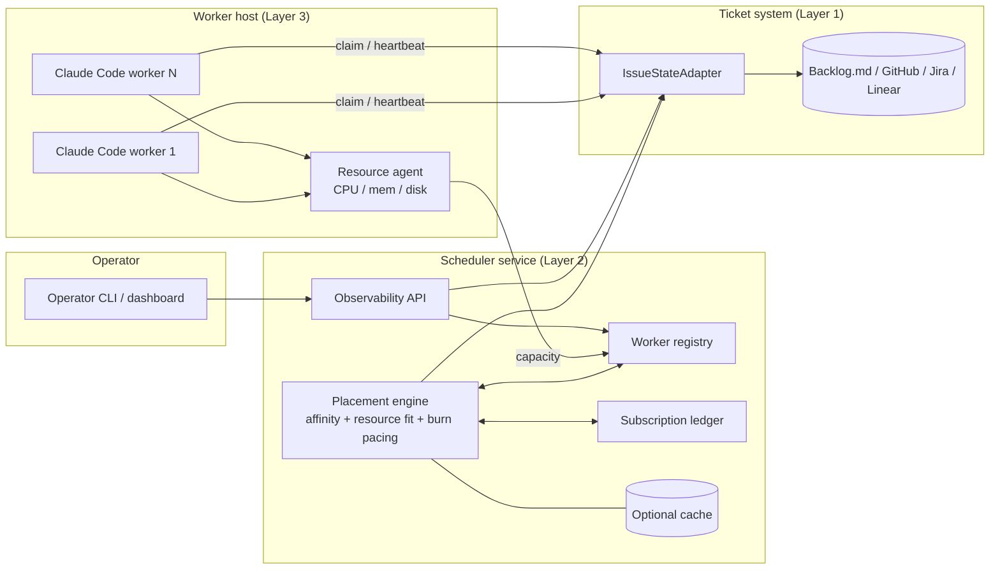

# RFC-0060: Distributed LLM-worker scheduler for multi-machine multi-tenant concurrent dispatch

**Status:** Draft
**Lifecycle:** Draft
**Author:** Dominique Legault
**Created:** 2026-10-28
**Updated:** 2026-10-28
**Target Spec Version:** v1alpha1

## Summary

Today's dispatch patterns (in-session, `cli-orchestrator` subprocess, N sibling sessions)
are single-machine and lifecycle-coupled. This RFC scopes a scheduler that places tasks
on LLM workers across laptops, VMs and Codespaces, for several humans in one org, while
keeping subscription billing primary and API tokens as overflow. It records the problem,
the component shape, the industry comparison, a four-phase plan and ten Open Questions.
It is a Draft: no design is decided and no implementation task is filed.

## Motivation

The operator needs:

1. **Observability**: real-time visibility into issue development across all in-flight work.
2. **Subscription billing primary**: the pipeline runs inside Claude Code sessions; API tokens are overflow.
3. **Multi-dimensional concurrency**: N sessions per laptop (resource-aware: CPU, memory, disk), N laptops per human, N humans per org, N VMs, N Codespaces, mixed billing tiers.
4. **Resource monitoring**: per-host telemetry feeds admission; do not dispatch while a host is under pressure.
5. **Subscription burndown optimization**: per-user weekly quota tracking, burn-rate projection and pacing, aiming at near-full use by the end of the quota window.
6. **Advanced scheduling**: affinity (reviewers on the operator's session for escalation, long dev tasks on idle capacity), fair-share across users, cost-aware routing.

The three existing patterns do not address items 3 to 6.

## Goals

- Define the component boundaries of a distributed scheduler and the OSS / enterprise split.
- Define the issue-state contract that keeps task state with the ticket, not in a scheduler-private queue.
- Outline four phases so each can be tasked after sign-off.

## Non-Goals

- Choosing an implementation, a hosting vendor or a queue technology (OQ-1, OQ-2).
- Per-phase task breakdown (deferred until sign-off).
- Changing the single-machine hierarchy of RFC-0051 or the ephemeral executors of RFC-0059.

## Proposal (sketch, undecided)

### Tier boundary

The distributed scheduler concerns (multi-tenant SaaS, regional sharding, cross-machine
coordination, subscription burn pacing) belong in the enterprise tier (`ai-sdlc-enterprise`
sibling repo). The OSS scope of this repo is bounded to:

- the Layer 1 adapter contract (`IssueStateAdapter` interface), so adopters can implement it;
- the Backlog.md reference adapter (validates the contract);
- the single-machine Layer 3 worker (the tmux N-pane wrapper, now the hierarchy of RFC-0051 and RFC-0059);
- no Layer 2 cache (small teams talk to the tracker directly).

Enterprise scope: adapters for Jira, Linear, GitHub Issues, ServiceNow and ADO; the Layer 2
cache; the multi-machine fleet registry; the subscription burn pacer; regional sharding;
the observability dashboard. Whether the full walkthrough happens in the enterprise repo
is itself part of OQ-1 and OQ-6 framing.

### Three layers

1. **Layer 1, issue state**: state lives with the issue, inside the ticket-system adapter, so it is shared by construction across machines and developers. The scheduler is agnostic to the tracker.
2. **Layer 2, scheduler / cache**: placement engine, worker registry, subscription ledger, optional local cache of tracker state.
3. **Layer 3, worker**: a Claude Code session plus a resource agent that pulls tasks, reports capacity and runs the Step 0-13 pipeline.

### IssueStateAdapter contract (draft)

Write: `setStatus(issueId, status, currentStep, lastHeartbeat)`, `attachWorkResult(issueId, prUrl, commitSha)`, `claimByWorker(issueId, workerId)` (atomic, prevents double dispatch), `releaseClaim(issueId)` (worker death).
Read: `listClaimedByWorker(workerId)`, `listUnclaimedReady()` (the frontier), `getStatus(issueId)`.

If state lives in the tracker, the scheduler may need no queue of its own; the adapter is the substrate and any database is an optional cache.

## Component Diagram

## Industry Comparison

| System | Lesson |
|---|---|
| Kubernetes pod scheduler | Worker registry, declarative resource model, eviction on pressure |
| HashiCorp Nomad | Multi-region, multi-cloud, heterogeneous scheduler; gossip-based discovery |
| Slurm (HPC) | Per-user fair-share and backfill; maps directly to subscription-burn optimization |
| AWS Batch / Karpenter | Cost-aware scheduling; maps to mixed subscription / API billing |
| Sidekiq Enterprise / Celery | Distributed task queues, multi-worker multi-host |
| GitHub Actions self-hosted runners | Pull-based worker registration, label-based routing |

## Velocity Impact (DEC-0048)

None at Draft: this RFC adds a document only. Each phase must state its own velocity
impact before sign-off; a phase that adds a gate on the dispatch path must show it
removes more waiting than it adds.

## Implementation Plan (outline; task breakdown deferred until sign-off)

| Phase | Outline |
|---|---|
| 1 | Single-host worker pool with capacity awareness: host telemetry agent and admission filter |
| 2 | Multi-host coordination: tracker-backed state (or hosted queue per OQ-1) and pull-based worker registration |
| 3 | Subscription-burn pacer: per-user ledger, projection and adaptive throttling |
| 4 | Observability surface: real-time in-flight view (TUI and/or dashboard) |

No tasks are filed for any phase until all ten OQs are resolved and the RFC is signed off.

## Open Questions

The operator walks these one at a time through the decision rubric (never batched). All
ten are unresolved.

### OQ-1: IssueStateAdapter contract and tracker support

What is the `IssueStateAdapter` contract, and which trackers does v1 support? This
reframes the original "managed vs self-hosted queue substrate" question: if state lives
with the issue, a separate queue substrate may be unnecessary. Candidates: Backlog.md
(single-file, collapses under concurrent multi-machine writes), GitHub Issues (labels,
Projects v2 fields, comments), Jira (rich, heavy), Linear (GraphQL, webhooks), fizzy.do
(free, less mature). Latency requirements and any residual queue substrate fall under this
question.

### OQ-2: Worker registration protocol

Pull or push; long-poll or SSE. Workers may register by claiming issues in the tracker
rather than with a separate scheduler.

### OQ-3: Per-user subscription quota source

Anthropic billing API access, operator-configured, or inferred from token usage.

### OQ-4: Placement policy

Capacity-fit versus fair-share-with-backfill; affinity rules.

### OQ-5: Resource telemetry agent

Separate process or piggybacked on the worker.

### OQ-6: Multi-tenant isolation

One queue per org, per user, or shared with priority classes. The tracker's own
project / workspace boundaries may be the isolation primitive.

### OQ-7: Failure model

Re-queue on worker death, cap on retries, or operator-only re-dispatch.

### OQ-8: Observability surface

Extend the existing TUI, a web dashboard, or both.

### OQ-9: Backward compatibility

Whether the existing Dispatch Board remains as an offline fallback.

### OQ-10: Cost-pool routing

Policy for subscription-near-full routing to API workers and for throttling when the API
budget is low.

## References

- RFC-0051 (session hierarchy), RFC-0059 (ephemeral executors), RFC-0041 section 4.1 (billing).
- Backlog task AISDLC-461 (this RFC) and AISDLC-462 (tmux N-pane wrapper, now superseded in practice by the hierarchy RFCs).
- Enterprise draft: `ai-sdlc-enterprise/backlog/drafts/draft-1`.

## Sign-Off

Not eligible: sign-off and Ready for Review only after all ten OQs are resolved.

| Role | Owner | Status | Date |
|---|---|---|---|
| Engineering | Dominique Legault | pending | |
| Operator | Dominique Legault | pending | |
| Product | | pending | |
| Design | | pending | |

## Revision History

| Version | Date | Change |
|---|---|---|
| v0.1 | 2026-10-28 | Draft: problem, component diagram, comparison, four-phase outline, ten unresolved OQs. |
